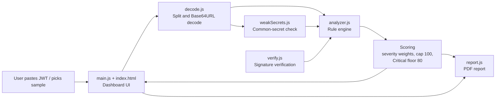
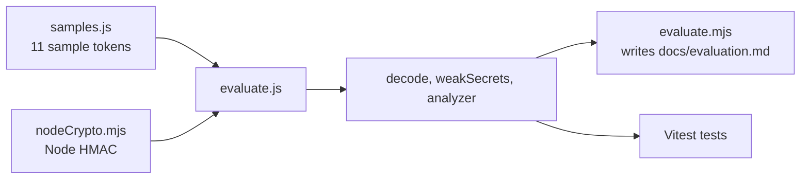

# TokenGuard: Architecture Documentation

*Moosa Raza (23L-2546), Muhammad Shayan (23L-3011), Muhammad Anas (23L-3005).*

## 1. Overview

TokenGuard is a client-side single-page application. All logic runs in the user's browser; there is no backend. The code is split into a **core** layer (`src/core`, pure logic, no DOM) and a **UI** layer (`main.js`, `index.html`, `src/ui`). This split is what allows the same core code to run in the browser, in the unit tests and in the evaluation script.

## 2. Component diagram

Evaluation and tests use the same pipeline with a different signing backend:

## 3. Components

| Component | File | Responsibility |
|---|---|---|
| Decoder | `src/core/decode.js` | Splits the token into three parts and Base64URL-decodes header and payload into JSON. |
| Weak-secret check | `src/core/weakSecrets.js` | Tries a list of common secrets against the token's signature using an injected `verify` function. |
| Rule engine | `src/core/analyzer.js` | Takes header, payload, signature result and weak-secret result; produces a list of findings, each with an id, severity and explanation. |
| Scoring | `src/core/analyzer.js` | Sums severity weights (Critical 40, High 25, Medium 10, Low 3, Info 0), caps at 100, then raises to at least 80 if any finding is Critical. Maps the score to a level. |
| Signature verification | `src/core/verify.js` | Checks the token's signature against a supplied secret or key. |
| Dashboard | `src/main.js`, `index.html`, `src/ui/dashboard.js` | Reads input, calls the core modules, shows findings, counts, score and level; hosts the sample dropdown. |
| UI helpers | `src/ui/renderer.js`, `tabs.js`, `toast.js`, `src/utils/time.js` | Rendering of decoded token and findings, tab switching, notifications, and time formatting. |
| PDF report | `src/core/report.js` | Builds a downloadable report from the analysis. The typed secret is excluded. |
| Samples | `src/core/samples.js` | 11 controlled tokens, each weak in exactly one way, plus one good control. Time claims are built from "now" so they never go stale. |
| Evaluation | `src/core/evaluate.js`, `scripts/evaluate.mjs` | Runs each sample through the pipeline, compares found rules to expected rules, and writes the results table. |

## 4. Data flow

1. The user pastes a token (or loads a sample) and optionally enters a secret or key.
2. `decode.js` returns `{ header, payload }`.
3. If a secret was given, the app verifies the signature. `weakSecrets.js` separately checks whether the token was signed with a common secret.
4. `analyzer.js` receives header, payload, signature result, weak-secret result, whether the key looks like a PEM, and the current time.
5. The rule engine returns findings, a score, a level and per-severity counts.
6. The dashboard displays the result; the PDF button passes the same analysis object to `report.js`.

## 5. Design decisions and rationale

**Client-side only.** Tokens and secrets are sensitive. Keeping everything in the browser means nothing is transmitted or stored, which also makes the tool trivial to host as a static site.

**Pure core, thin UI.** The core modules take plain inputs and return plain data, with no DOM access. This made them easy to unit-test and to reuse in the evaluation script.

**Dependency injection for crypto.** The core receives `sign` and `verify` functions instead of importing a crypto library. The app passes jsrsasign (browser); the tests and evaluation pass Node's built-in `crypto`. Because both signing backends are accepted by the same checks, we confirmed the browser and Node produce interchangeable tokens (11 of 11 samples).

**Injected clock.** `analyzeToken` and the samples take `now` as a parameter, so time-based rules (expiry, not-before, lifetime) are deterministic in tests.

**Rule engine as a list of independent checks.** Each rule is separate and has a stable id (such as `ALG_NONE`). This makes the evaluation straightforward: each sample declares which ids it expects.

**Severity-weighted score with a Critical floor.** Summing weights alone gave the unsigned token and weak-secret token only 40 ("Medium"), which understated them. A single Critical finding means the token cannot be trusted, so the score is now at least 80. Two unit tests cover this behaviour.

**Controlled samples.** Each weak sample has one deliberate flaw, so a missed rule is attributable to exactly one cause. The control sample must produce zero findings, which tests for false positives.

## 6. Technology choices

| Choice | Reason |
|---|---|
| Vanilla JS modules + Vite | Small, fast, no framework overhead; static output. |
| jsrsasign | Browser-side JWS signing and verification. |
| Vitest | Fast unit tests that run the ES modules directly. |
| Node `crypto` (tests/evaluation only) | Built in, no extra dependency. |

## 7. Coverage of the project proposal

How each module promised in the proposal maps to the code. Rows marked **Verify** are ones I could not confirm without seeing your source; check them before submitting.

| Proposal module | What was promised | Implemented in | Status |
|---|---|---|---|
| 3.1 Decoding and inspection | Decode and show header and payload in a structured format | `decode.js`, `ui/renderer.js` | Done |
| 3.2 Security validation | Check expiry, validity period, registered claims, algorithms; verify signatures when a key is available | `analyzer.js` rules, `verify.js` | Done |
| 3.3 Vulnerability detection and risk assessment | Severity classes (Low to Critical) and a risk score from predefined criteria | `analyzer.js` (weights, cap, Critical floor) | Done |
| 3.4 Security analytics dashboard | Vulnerability counts, severity distribution, scores | `ui/dashboard.js`, `ui/tabs.js` | **Verify** that severity distribution is shown visually, not only as counts |
| 3.5 Security recommendations | Advice on algorithms, claim validation, verification, best practice | findings text in `analyzer.js` and `report.js` | **Verify** that every rule produces a recommendation |
| 3.6 Report generation | Downloadable PDF with findings, severities, score, mitigations; no sensitive token contents or secrets | `report.js` | **Verify** that the PDF contains neither the secret nor the full raw token (Phase 9 only confirmed the secret) |
| 3.7 Project limitations | Not a penetration-testing tool; no attacks on external systems; no certification | `SECURITY_ANALYSIS.md` section 7 | Done |
| Section 4: testing with controlled JWT samples | Evaluate effectiveness on known weaknesses | `samples.js`, `evaluate.js`, `scripts/evaluate.mjs` | Done |

## 8. Extending the tool

To add a rule: add the check in `analyzer.js` with a new id and severity, add a sample in `samples.js` that triggers it, and run `npm test` and `npm run evaluate`.